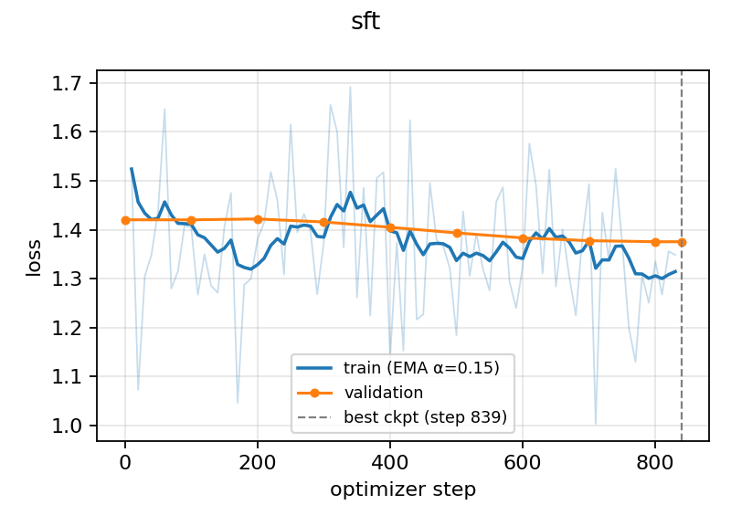
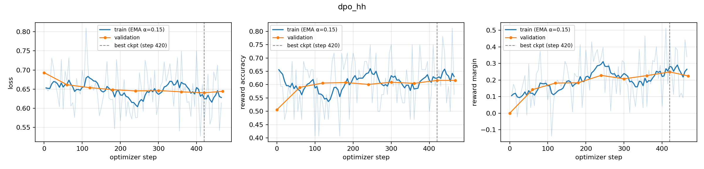
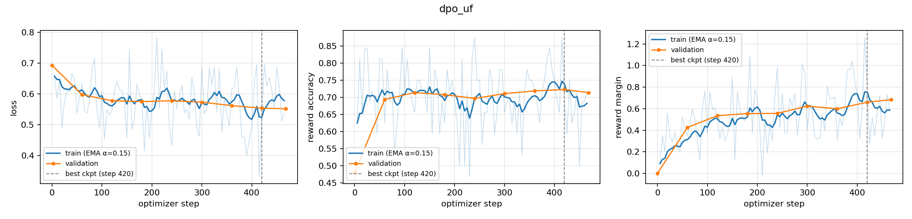

# CS5323 PA2: SFT + DPO on Qwen2.5-0.5B

Nifra Wahaj (25280002)

- **Report:** [report/PA2_25280002.pdf](report/PA2_25280002.pdf)
- **Evaluation summary (DPO vs SFT):** [table below](#evaluation-summary) · [results/eval/summary_table.csv](results/eval/summary_table.csv)
- **Training plots:** [shown below](#training-plots) · [SFT](results/plots/sft.png), [DPO-HH](results/plots/dpo_hh.png), [DPO-UF](results/plots/dpo_uf.png)

## Evaluation summary

Judge: `google/gemini-3.6-flash`, blind A/B, every call in a fresh chat. Win rates exclude ties; "Unknown" means the judge left the item out of its reply. Source: [results/eval/summary_table.csv](results/eval/summary_table.csv).

| Comparison | Eval set | n | Win | Tie | Loss | Unknown | Failed | Win rate | Win rate (tie = ½) |
|---|---|---|---|---|---|---|---|---|---|
| DPO-HH vs SFT | HH safety | 300 | 144 | 36 | 114 | 6 | 0 | **55.8%** | 55.1% |
| DPO-UF vs SFT | AlpacaEval | 300 | 123 | 29 | 130 | 18 | 0 | **48.6%** | 48.8% |
| SFT vs base (extra) | AlpacaEval | 300 | 253 | 1 | 36 | 10 | 0 | **87.5%** | 87.4% |
| LoRA vs SmolLM2, style | Persona | 24 | 8 | 14 | 2 | 0 | 0 | **80.0%** | 62.5% |
| LoRA vs SmolLM2, quality | Persona | 24 | 8 | 2 | 14 | 0 | 0 | **36.4%** | 37.5% |

Per-comparison details, including the HH per-category breakdown, are in [`results/eval/*_judged.summary.json`](results/eval/).

## Training plots

**SFT** ([results/plots/sft.png](results/plots/sft.png))



**DPO-HH** ([results/plots/dpo_hh.png](results/plots/dpo_hh.png))



**DPO-UF** ([results/plots/dpo_uf.png](results/plots/dpo_uf.png))



## Layout

- `submission_adapter.py` is the grading interface. It wraps the code in `sproutlm/`.
- `configs/` has the hyperparameters, and `notebooks/` has the four Kaggle notebooks (see below).
- `results/` has the training metrics and configs (`train/`), plots, generations (`gen/`), and the pair files, per-pair verdicts and summaries (`eval/`). `eval/run1_shared_context/` is the discarded first judging run that the report discusses. `runs/kaggle_executed/` has the executed notebooks.
- To run the tests: `PYTHONPATH=. python -m pytest -q tests`

## How to run

The notebooks run on Kaggle in this order. Each one needs the previous notebook's saved output attached as an input.

```
01_setup_sft ──► 02_dpo ──► 03_lora_generate_pairs ──► 04_judge
   ~1.1 h          ~3.1 h          ~0.3 h                 ~0.6 h
```

| Notebook | Accelerator | Attach as input | Does | Writes |
|---|---|---|---|---|
| `01_setup_sft` | GPU T4 x2 | none | Tests, freezes the AlpacaEval-300 subset (seed 42), runs SFT on both GPUs | `outputs/sft/{best,final}` |
| `02_dpo` | GPU T4 x2 | 01 | DPO on HH-RLHF, then on UltraFeedback (policy on cuda:0, reference on cuda:1) | `outputs/dpo_{hh,uf}/{best,final}` |
| `03_lora_generate_pairs` | GPU T4 x2 | 01 + 02 | LoRA-DPO on SmolLM2, generates every output, builds the blind pair files | `outputs/gen/`, `outputs/eval/*_pairs.jsonl` |
| `04_judge` | none | 03 | Judges every pair file (5 per call, 5 s sleep, 3 retries, a fresh chat for each call) | `outputs/eval/*_judged.jsonl`, `*.summary.json` |

1. Import a notebook with **File → Import Notebook**, and turn Internet on.
2. Run it with **Save Version → Save & Run All**. The saved output is what the next notebook attaches.
3. Create `04_judge` from **Kaggle Benchmarks**, so that `kaggle_benchmarks` is available. If notebook 03's output isn't mounted there, the notebook clones this repo and reads `results/eval/` instead.

The notebooks clone this repo, so it has to be public while they run.
